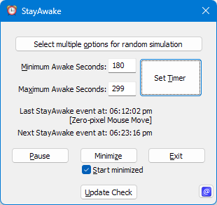
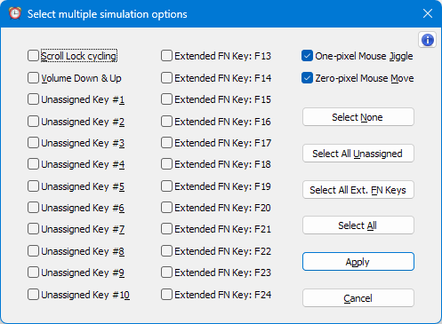
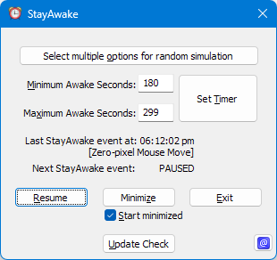
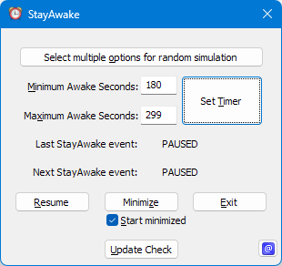
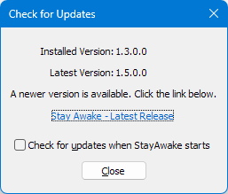

# StayAwake

 &nbsp;&nbsp;&nbsp;&nbsp;&nbsp;

 &nbsp;&nbsp;&nbsp;&nbsp;&nbsp;

 &nbsp; 

[Current Version: 1.5.0.0](VersionHistory.md)

StayAwake is a simple utility that enables you to maintain an _Active_ status on Microsoft Teams (and perhaps other messaging applications such as Slack and Zoom). StayAwake also prevents screen saver activation, screen blanking, and Windows session lockouts.

## Features at a glance
* Randomized simulation with mouse or key inputs. Roster with a choice of 24 no/low side-effect keys and 2 invisible mouse moves.
* Random interval simulation. Intervals within a specified range of seconds.
* Helpful status information with timestamps of Last and Next simulations.
* Minimization to System Tray.
* Start Minimized option.
* Manual Pause feature when needed.
* Automatic Pause while Windows in locked state. Reduces disk activity and CPU usage. Conserves battery power.
* Small, portable application. Runs with no installation or administrator privileges.
* Digitally signed application executable file.
* Update Check feature - Manual or automatic (opt-in).

If you are using Microsoft Teams, you may have noticed that Teams automatically sets your status to _Away_ after a certain period of inactivity. This can be frustrating if you are still at your desk but perhaps on a business phone call _OR_ outlining a plan on paper _OR_ consulting some reference material.

StayAwake simulates a randomly selected input from a specified roster of jitter-free mouse moves and no/low side-effect keys. Additionally, these simulations are done at random intervals within a specified range of seconds. This is a safe and non-intrusive way to keep your Microsoft Teams status _Active_. The combined randomness of inputs and time intervals eliminates predictable patterns, making StayAwake simulations seem organic.

StayAwake can be minimized to the Windows System Tray, and will continue to run in the background until you click the _Exit_ button. StayAwake also has the option to automatically minimize to Windows System Tray upon launch. See: [Start Minimized](#start-minimized)

StayAwake executable is now digitally signed by the kind folks at [OSSign](https://www.ossign.org). Thanks to the code signing, there is *NO* need for users to override the Windows Defender Smartscreen or [unblock the executable file](https://stackoverflow.com/questions/48946680/how-to-avoid-the-windows-defender-smartscreen-prevented-an-unrecognized-app-fro) to launch StayAwake.

## User Interface

#### Select multiple options for random simulation
StayAwake can randomly pick any of the 26 inputs (24 key codes & 2 mouse moves) during each simulation. Users can specify _at least_ one OR a select few OR all of the 26 inputs to be included in the simulation roster. See [Input Simulation Options](InputOptions.md) for more info.

#### Minimum Awake Seconds
This field allows you to specify the minimum interval between key simulations. The initial default value for this is 240 seconds (_i.e._, 4 minutes). However, you can change this to any value between 10 and 9990 seconds. Your new value will be saved and used the next time you run StayAwake.

#### Maximum Awake Seconds
This field allows you to specify the maximum interval between key simulations. The initial default value for this is 240 seconds (_i.e._, 4 minutes). However, you can change this to any value between 10 and 9990 seconds. Your new value will be saved and used the next time you run StayAwake.

**Tip**: If Microsoft Teams is changing your status to _Away_ after 5 minutes (i.e., 300 seconds) of inactivity, consider setting the *Minimum Awake Seconds* to around 200 and the *Maximum Awake Seconds* to 310 or 320 or even 330 (i.e., a little over 300). This weighted range will cause your Teams status to briefly drift out of _Active_ status once in a while -- a more normal user behavior from your coworkers' perspective than a solid green status through an entire work day.

#### Set Timer button
After changing the value for either *Minimum Awake Seconds* or *Maximum Awake Seconds*, click this button to apply the new setting. Clicking this button will also immediately invoke an Awake event.

After every Awake event, a random number of seconds (between the specified minimum and maximum seconds) will be picked to run the next Awake event.

The clock times of the last and next Awake events will be displayed and continually refreshed on the StayAwake window. The randomly picked input option used for the last Awake will also be displayed below the last Awake time.

#### Pause button
Click this button to pause StayAwake Key simulations.

As seen in the clip above, clicking the *Pause* button will also have these effects:
1. The *PAUSED* state will be indicated in the *Next StayAwake event* time slot.
2. The *Pause* button will change to _Resume_ mode. To exit the *PAUSED* state, click the **Resume** button.
3. If StayAwake is closed while still in paused mode, StayAwake will reopen in paused mode when it is launched the next time. To exit the *PAUSED* state, click the **Resume** button.

   

4. On a related note, if the Windows system has been manually locked, StayAwake will pause key and mouse simulations until the system gets unlocked again. This will help reduce disk activity and CPU usage (thus conserving battery power on laptops) while the system is in locked state.

#### Minimize button
Click this button to minimize StayAwake to the Windows System Tray. See the [SystemTray Icon](#system-tray-icon) section below for more info.

#### Exit button
Click this button to exit StayAwake.

#### Start Minimized
Check the _Start minimized_ box to have StayAwake automatically minimize to System Tray upon launch.

When the _Start Minimized_ option is enabled, StayAwake will launch and minimize immediately only on the first launch attempt. If StayAwake is still running in a minimized state, trying to launch the application again will restore the StayAwake dialog from the minimized state. This is by design when `MultipleInstancesAllowed=N`. See under: [Configuration File Details](#configuration-file-details)

#### Update Check button
Click this button to manually check if a newer version of StayAwake is available. When clicked, the _Check for Updates_ dialog will popup.

The _Check for Updates_ popup will display the Installed and Latest Version numbers.

If a newer version is available, the popup will display a clickable link that redirects to the [StayAwake - Latest Release](https://github.com/shriprem/StayAwake/releases/latest) page.

In this popup, you can also enable the _Check for updates when StayAwake starts_ option to have StayAwake automatically check for a newer version every time it is launched. This is an opt-in feature that is unchecked by default.

### System Tray Icon

When you minimize StayAwake, it will be represented by the System Tray icon shown above. You can click on this icon to access the following context menu:

* **Restore**: Click this to restore StayAwake window.

* **Exit**: Click this to exit StayAwake.

## Configuration File Details
StayAwake saves its configuration in a file named `StayAwake.ini`. This file is co-located in the `StayAwake.exe` application file folder. These key-value pairs are stored in this file:

1. `SelectedKeyCodes`: This key stores a string of 26 characters -- each character indicating if a key code or mouse move in the [Input Simulation Options](InputOptions.md) popup is enabled or not with either a `1` or `0`, respectively.

   If an invalid value is detected for this key, the default value of `00111111111111111111111111` (i.e., enabling of all inputs except *Scroll Lock cycle* and *Volume Down & Up*) will be used instead.

2. `MinimumIntervalInSeconds`: This key stores the minimum number of seconds between each StayAwake Key simulation as specified in the [Minimum Awake Seconds](#minimum-awake-seconds) field.

   The `MinimumIntervalInSeconds` value must be an integer between 10 and 9990. Values outside this range will be ignored and the default value of 240 seconds will be used instead.

3. `MaximumIntervalInSeconds`: This key stores the maximum number of seconds between each StayAwake Key simulation as specified in the [Maximum Awake Seconds](#maximum-awake-seconds) field.

   The `MaximumIntervalInSeconds` value must be an integer between 10 and 9990. Values outside this range will be ignored and the default value of 240 seconds will be used instead.

4. `AwakePaused`: This key stores a flag value (_Y_ or _N_) to indicate if StayAwake is in paused state.

5. `StartMinimized`: This key stores a flag value (_Y_ or _N_) to indicate if StayAwake will automatically minimize to System Tray upon launch. See: [Start Minimized](#start-minimized)

6. `StartCheckUpdates`: This key stores a flag value (_Y_ or _N_) to indicate if StayAwake will automatically check for a newer version every time it is launched. See: [Update Check button](#update-check-button)

7. `MultipleInstancesAllowed`: This key stores a flag value (_Y_ or _N_) to indicate whether multiple instances of StayAwake are allowed to run simultaneously. The default value is _N_ (i.e., multiple instances are not allowed). Any value that is not _Y_ will be interpreted as _N_.

## Alternatives

### StayAwake plugin for Notepad++
StayAwake is also available as a [plugin for Notepad++](https://github.com/shriprem/StayAwake_NPP_Plugin). This version can be useful if you have Notepad++ open during your typical workday. You will be spared the need to separately run the standalone StayAwake application.

### Adobe PDF Full screen hack
If you are only looking for a way to block screen saver activation and session lockouts, you do not actually need StayAwake. Instead, you can simply open a PDF document in full screen mode in Adobe Acrobat (Reader | Professional), and leave it open in the background. This will prevent your screen saver from activating, and also prevent your Windows session from locking out.

**Note**: Full screen mode is different than maximized window state. To view a PDF document in full screen mode in Adobe Acrobat (Reader | Professional), either use:
* The menu option: *View » Full screen mode*
* Or the much quicker keyboard shortcut: *Ctrl + L*.

However, if you are looking for a way to keep your Microsoft Teams status _Active_, then StayAwake is the right tool for you.

## Installation

StayAwake is a portable application and does NOT require installation with administrator privileges. Simply download the latest release from the [Releases](https://github.com/shriprem/StayAwake/releases) page and unzip the contents to a folder of your choice. Run the `StayAwake.exe` application file to start the utility.

If you like StayAwake, please star this repo. Thank you for your appreciation.

If you would like to support its development, you can buy me a coffee by clicking the button below. Thank you for your support!

